# Windows Server 2019 Enterprise Lab

A hands-on homelab built from my MCSA coursework. Each phase deploys and configures a real Windows Server role on VMware Workstation, shows **both the GUI and the PowerShell method**, and keeps screenshots as evidence.

## Phase 1: Deploy and configure the server (this repo)

**MCSA topics:** 1 Deploy Windows Server in VMware, 21 Local server basic configuration

**Skills shown:** virtual lab design, Windows Server installation, static IP addressing, hostname and time zone configuration, PowerShell administration, GUI and command-line verification.

### Lab design

| Item | Value |
| --- | --- |
| Hypervisor | VMware Workstation |
| Guest OS | Windows Server 2019 Standard Evaluation (Desktop Experience) |
| VM / hostname | `DC01` |
| vCPU / RAM / disk | 2 / 2 GB / 60 GB |
| Network | VMnet1, host-only, isolated from the home network |
| Subnet | 192.168.10.0/24, VMware DHCP service turned off |
| IP address | 192.168.10.10 (static), no gateway |
| DNS server | 127.0.0.1 (the server itself, ready for the AD DS and DNS role) |

VMware's DHCP is off on purpose: a Windows DHCP server replaces it in a later phase.

## Step 1: Deploy the VM

1. Download the **Windows Server 2019 Evaluation ISO** (64-bit, English) from the Microsoft Evaluation Center. It is free for 180 days.
2. In **Edit > Virtual Network Editor**, select **VMnet1**, keep it **Host-only**, untick **Use local DHCP service**, and set subnet `192.168.10.0` / mask `255.255.255.0`.
3. Create the VM with **File > New Virtual Machine > Custom**, attach the ISO, name it `DC01`, set 2 processors, 2 GB RAM and a 60 GB disk, and set the network adapter to **Custom: VMnet1**.
4. Install **Windows Server 2019 Standard Evaluation (Desktop Experience)** using **Custom: Install Windows only**, and set the Administrator password.
5. Install VMware Tools (Typical) and reboot.
6. Optional but recommended: take a snapshot called `clean-install` so you can roll back.

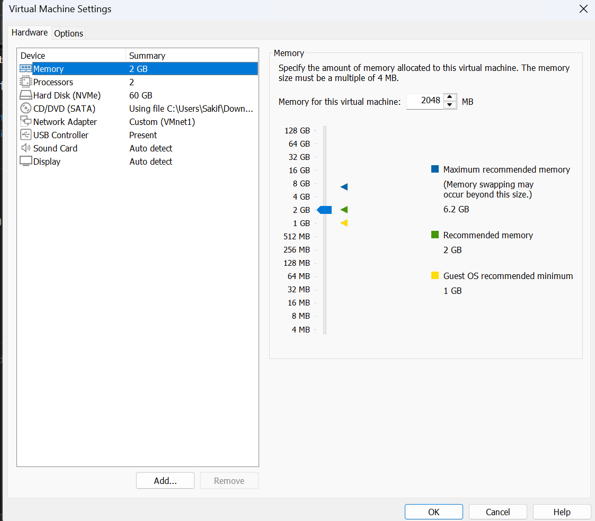

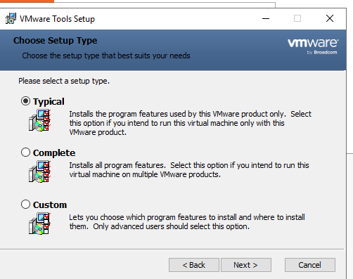

## Step 2: Basic configuration

Find the adapter name first:

```powershell
Get-NetAdapter
```

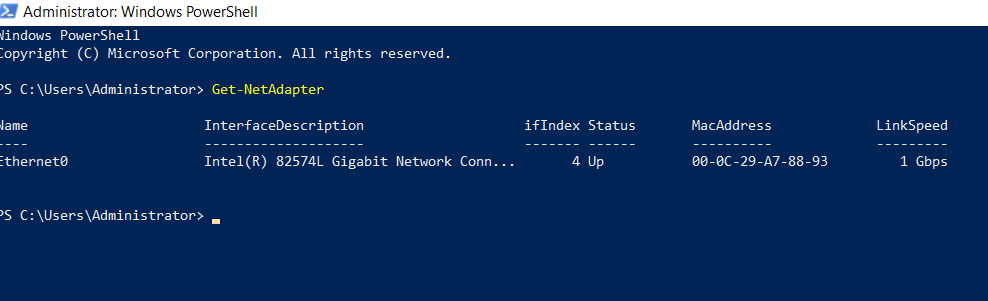

### Method A: PowerShell

Open PowerShell **as Administrator**.

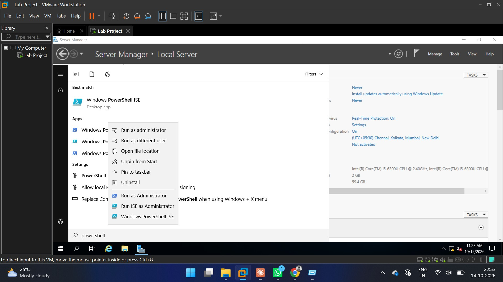

Run the commands (also saved as [`scripts/01-basic-config.ps1`](scripts/01-basic-config.ps1)):

```powershell
Rename-Computer -NewName DC01
New-NetIPAddress -InterfaceAlias "Ethernet0" -IPAddress 192.168.10.10 -PrefixLength 24
Set-DnsClientServerAddress -InterfaceAlias "Ethernet0" -ServerAddresses 127.0.0.1
Set-TimeZone -Id "India Standard Time"
Restart-Computer
```

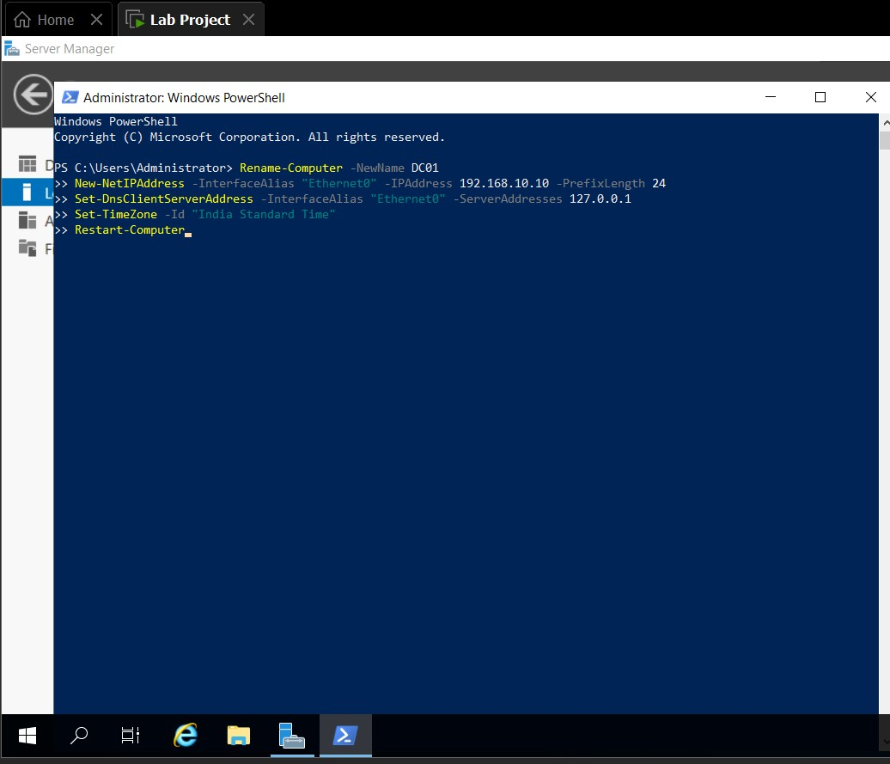

### Method B: GUI

**Computer name** (Server Manager > Local Server, then click the computer name):

1. In **System Properties > Computer Name**, click **Change...**.
2. Enter `DC01`, click **OK**, and restart when asked.

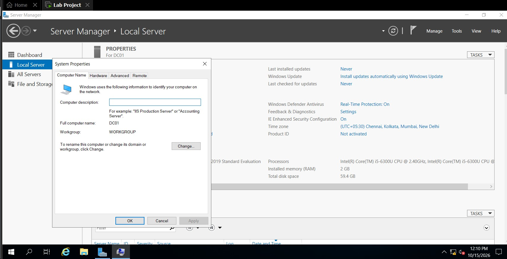

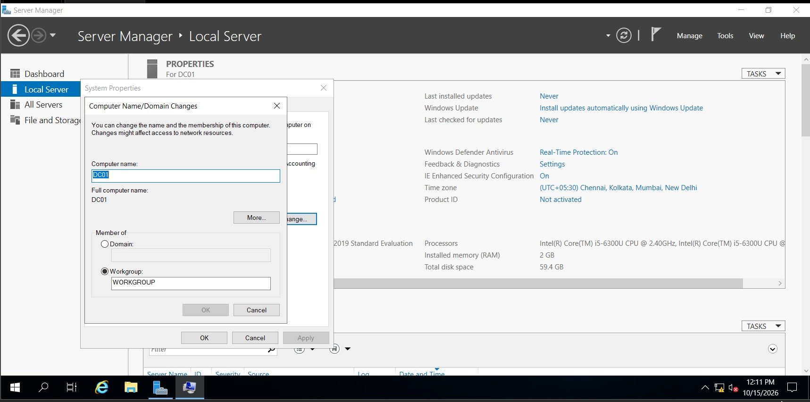

**Static IP address** (run `ncpa.cpl`):

1. Right-click **Ethernet0** and choose **Properties**.
2. Select **Internet Protocol Version 4 (TCP/IPv4)** and click **Properties**.
3. Choose **Use the following IP address** and enter IP `192.168.10.10`, mask `255.255.255.0`, no gateway.
4. Choose **Use the following DNS server addresses** and enter `127.0.0.1`, then click **OK**.

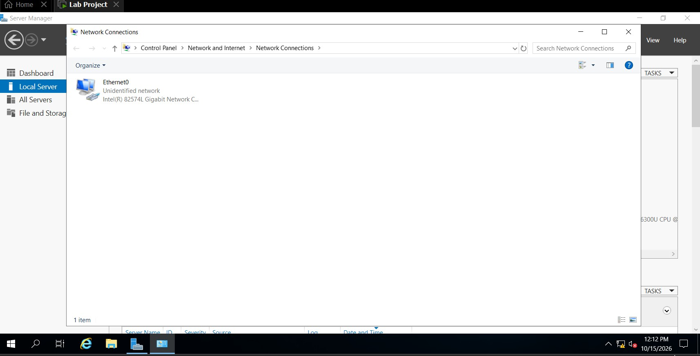

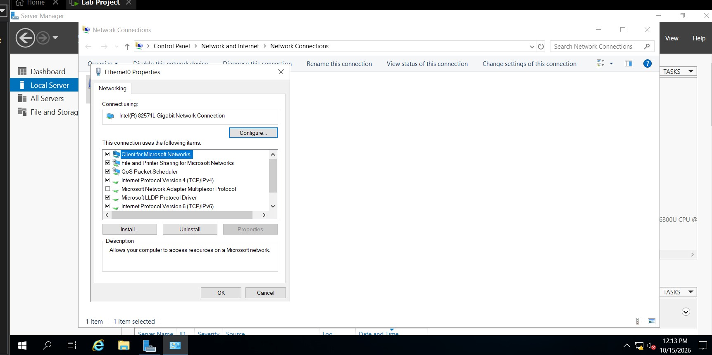

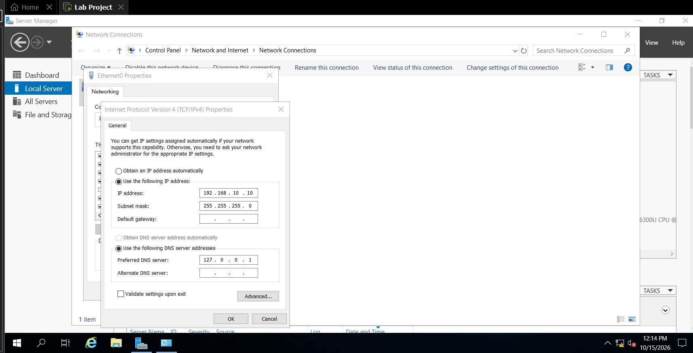

**Time zone:** Server Manager > Local Server > click the **Time zone** value > **Change time zone...** > `(UTC+05:30) Chennai, Kolkata, Mumbai, New Delhi`.

## Step 3: Verify

After the restart, run (also saved as [`scripts/02-verify.ps1`](scripts/02-verify.ps1)):

```powershell
hostname
ipconfig /all
```

Expected: hostname `DC01`, IPv4 `192.168.10.10`, mask `255.255.255.0`, DHCP disabled, DNS `127.0.0.1`.

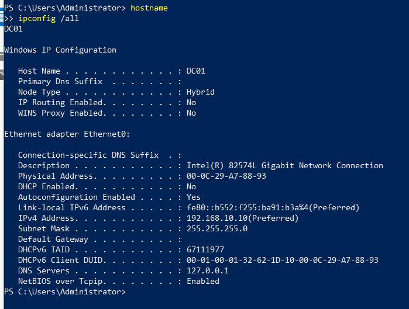

Server Manager confirms the same settings: computer name `DC01`, Ethernet0 `192.168.10.10`, time zone UTC+05:30, 2 GB RAM, 59.4 GB disk.

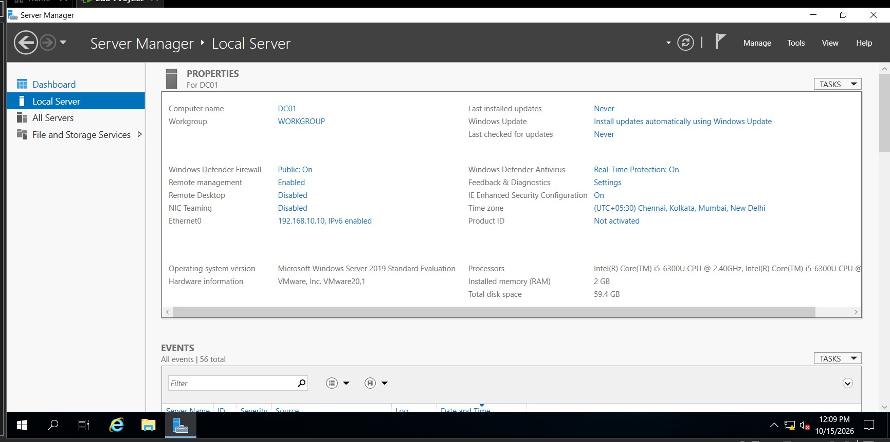

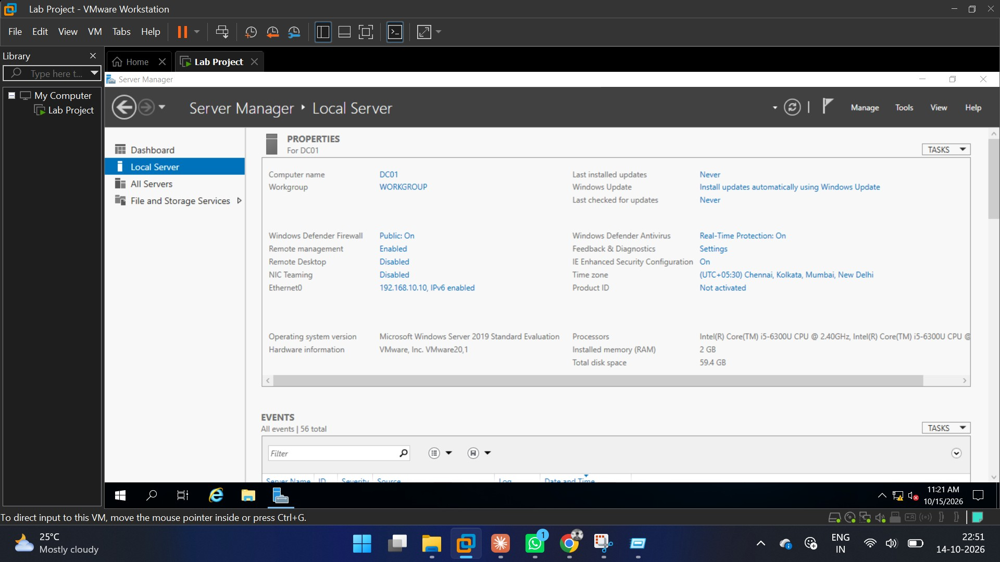

## Issues and fixes

| Problem | Fix |
| --- | --- |
| VM settings still listed **NAT** after choosing VMnet1 | Click **OK** to save the change, then check the device list reads **Custom (VMnet1)** |
| "Try managing servers with Windows Admin Center" pop-up at first login | Not an error. Tick **Don't show this message again** and close it |
| Adapter name not `Ethernet0` | Run `Get-NetAdapter` and use the name it shows |
| Network Connections shows **Unidentified network** | Expected: the host-only network has no gateway and no DHCP |

## Roadmap

Next up is installing the AD DS and DNS roles and promoting DC01 to a domain controller (the wizard's first screen is in [`screenshots/14-add-roles-select-server.png`](screenshots/14-add-roles-select-server.png)).

| Phase | Topics | Status |
| --- | --- | --- |
| 1 Deploy and configure | 1, 21 | Done |
| 2 Domain core | AD DS, DNS, DHCP, reserved IP, users and passwords, client access | Next |
| 3 Multi-site and resilience | DNS zone transfer, RODC, NLB, Hyper-V | Planned |
| 4 Services and deployment | Software deployment, WDS, remote access, WSUS, IIS | Planned |
| 5 PKI and federation | AD CS, AD FS | Planned |

## Repository layout

```
windows-server-2019-lab/
├── README.md
├── scripts/
│   ├── 01-basic-config.ps1
│   └── 02-verify.ps1
└── screenshots/
```
